[English](README.md) | [简体中文](README.zh.md)

[](#install)
[](https://pnpm.io/)
[](https://github.com/deepseek-ai/deepseek-harness)
[](LICENSE)
[](https://github.com/easyzoom/dsh-aixterm/actions/workflows/ci.yml)



# dsh-aixterm

SSH / SFTP session manager for **DeepSeek Harness** — **shared by the human and the AI agent**. The human uses a sidebar page; the agent uses tools; both drive the **same saved sessions** and the **same per-session command log**, so each side sees exactly what the other did.

## Features (v0.1)

- **Saved SSH sessions** — password / private-key / ssh-agent, named and grouped.
- **Sidebar page** (under Plugins) with a connection list and real **xterm.js terminals**: multiple tabs, SSH and local shells, full keyboard, resize, scrollback and clickable links.
- **SFTP file browser** — browse remote directories, **drag-and-drop upload** and one-click **download**.
- **Shared interactive terminal (human + agent)** — the agent opens the same PTY with `aixterm_term_open` and reads/sends with `aixterm_term_read` / `aixterm_term_send`.
- **Shared log (human + agent)** — every one-shot run, from the UI (`source: human`) or a tool (`source: agent`), is recorded with command, output, exit code and time.
- **Agent tools** — `aixterm_list_sessions`, `aixterm_run`, `aixterm_sftp_list`, `aixterm_test`, and the terminal trio above.
- **Secrets encrypted at rest** — passwords / key passphrases are AES-256-GCM encrypted in the data dir.
- **Port forwarding** — local (`-L`), remote (`-R`) and dynamic SOCKS5 (`-D`), with jump hosts and shared connections.
- **Full SFTP management** — mkdir / rename / delete / chmod, inline text editor, and a panel that follows the terminal's cwd.
- **Resource monitor** — CPU, memory, load, disk and network rates for the active session.
- **Collapsible side panels** — the session list (left) and the monitor/SFTP column (right) collapse to a slim icon strip and restore with one click, remembered across reloads.
- **Split view** — single, two panes side by side, two panes stacked, or a 2×2 quad grid; the tab-bar button cycles the layouts and every extra pane picks its terminal from a dropdown.
- **Command history and fuzzy suggestions** — commands typed in a terminal are recorded per session (persisted, deduplicated); typing a prefix shows up to five history matches and Tab completes the first one. Suggestions are hidden automatically in full-screen programs (alternate screen: vim, top, less …).
- **Line-number / timestamp gutter** — optional left gutter showing buffer line numbers, wall-clock timestamps, or both; it follows scrolling and is per-terminal.
- **Comfort features** — session search and duplicate, terminal find (`Ctrl+F`), context menu (copy/paste/find/download log/clear screen/clear scrollback/reset terminal), five colour themes, font family/size/line height, keyword highlighting (custom patterns + colours), broadcast input, log export (txt/HTML).
- **Auto-reconnect** — terminals reconnect with exponential backoff after a drop.
- **Danger-command approval** — agent-initiated `aixterm_run` / `aixterm_term_send` calls matching a configurable pattern list wait for the human's approval, and fail closed when no approval surface exists.
- **Credential references** — a session may name a dsh credential-service key (`credentialEnv`) instead of storing a password.
- **Session import/export** — export JSON (round-trip) or MobaXterm `.mxtsessions`; import Xshell `.xsh`, MobaXterm and this plugin's JSON. Secrets are excluded and jump hosts are kept by name.
- **Managed SSH keys** — generate ed25519 or import existing private keys; sessions reference them by name. Keys live under `<dataDir>/keys` with mode 600.
- **Telnet sessions** — telnet `host:port` with IAC negotiation in the same terminal UI (SSH-only panels stay hidden).
- **Serial sessions** — open local serial ports (device path, baud rate, data/stop bits, parity) in the same terminal UI as SSH.
- **X11 forwarding** — optional per-session forwarding to the local X server (needs `xauth` on the server and `DISPLAY` locally).
- **ZMODEM** — remote `sz` downloads save to disk automatically; remote `rz` opens a local file picker (powered by zmodem.js).
- **AI assistant panel** — ask the model about the current terminal; it sees the session, cwd, recent commands and scrollback, and suggested commands can be run with one click. Paste or attach a screenshot and the vision model reads it — terminal output, resource charts, anything. The **→ Session** button instead sends the question (and image) into the main dsh conversation, so main-agent history, tools, approvals and session management all apply. The target picker can create a new session with a chosen workspace and agent preset, and **↗** opens that session in the main workspace. The panel mirrors the main session live: user messages, assistant replies, tool calls and turn errors stream into the panel, so both sides share one conversation.
- **Scrollback persistence** — toggle saving and set the directory in the settings panel; when saving is off only an in-memory circular buffer is kept. Its line count is configurable (100–100,000, default 2,000).
- **`@`-session analysis for agents** — `aixterm_read_log` / `aixterm_analyze` accept a session name, letting the agent analyze a terminal the conversation references with `@<name>`.
- **Lock screen, master password and idle auto-lock** — set a master password (scrypt) to lock the panel manually or after N idle minutes; every API except the lock endpoints returns 423 while locked.
- **Wide session import** — auto-detects Xshell `.xsh`, MobaXterm `.mxtsessions`, SecureCRT `.ini`, WindTerm, FinalShell, Termius, Electerm and NyaTerm JSON, plus this plugin's own export.
- **Richer monitor** — CPU, memory, load, disk, network rates plus hostname, kernel, uptime, logged-in users and (when available) SoC temperature.
- **tmux integration** — list, create and kill remote tmux sessions; opening a terminal attaches (or creates) a named session so the shell survives reconnects; `aixterm_tmux_sessions` exposes the list to agents.
- **Right-click session menu** — connect, disconnect, edit configuration, duplicate, tmux, port forwarding, log export, test and delete all live in one context menu instead of row icons. The list distinguishes saved entries (hollow dot) from live connections (filled dot).
- **Macros** — record the commands typed in a terminal, save them as a named macro, and replay them in order (configurable delay) in any session; edit or delete them from the macro panel.
- **Transfer queue** — uploads and downloads run through a queue with progress, live speed, pause/resume, cancel, retry, resume-from-offset, duplicate handling (overwrite / skip / rename) and timestamp preservation (mtime kept on both sides).
- **Configurable data dir** — session files, the encryption key and terminal scrollback logs share one directory (plugin config `dataDir`, default `$DSH_HOME/aixterm`).

## Install

Use the bundled `dsh` CLI. Replace `<profile>` with your profile name (`desktop` for the app, `web` for `dsh web`, …).

```bash
# 1) git source (main channel)
dsh plugin --profile <profile> add "github:easyzoom/dsh-aixterm#main"

# 2) npm (once published to npm)
dsh plugin --profile <profile> add dsh-aixterm

# 3) local dev (a checkout of this repo)
dsh plugin --profile <profile> add /path/to/dsh-aixterm
```

Notes:
- The **desktop profile is locked by the running app** — close DeepSeek Harness before a CLI install.
- The git source works for a private repo too when your git credentials are set.
- The npm command requires the package to be published first.

## Using it from the chat

The plugin registers an embedded **aixterm** skill and a set of tools, so the dsh conversation can drive terminals directly:

- `@test 看看最近报了什么错` → `aixterm_read_log` / `aixterm_analyze`
- `在 test 上执行 df -h` → `aixterm_run` (dangerous commands ask for approval)
- `把 test 的资源情况汇总一下` → `aixterm_analyze`
- `帮我加一个到 10.0.0.5 的会话，用户 root` → `aixterm_create_session`
- `test 上有哪些 tmux 会话` → `aixterm_tmux_sessions`
- `在 test 的终端里执行 make` → `aixterm_term_send` with `session` (writes to the open terminal, no terminalId needed)
- `所有 SSH 服务器执行 uptime` → `aixterm_run_all` (one batch approval for dangerous commands)
- `把 deploy 宏在所有机器上跑一遍` → `aixterm_run_macro`
- `看看 AI 面板刚才怎么说的` → `aixterm_ai_history`

Tools accept a session id **or exact name**, so `@<session name>` references work. The AI panel history is shared with the chat.

## Usage

1. Open the sidebar **SSH 会话** page → **+ 新建** → fill in host / port / user / auth → save. The session opens in a terminal tab.
2. Or click **本地终端** for a local shell (PowerShell / `$SHELL`).
3. For an SSH tab, the **文件 (SFTP)** panel on the right lists the home directory. Click a folder to enter it; **drag files onto the panel** to upload; click **↓** to download.
4. The agent can open the same interactive terminal with `aixterm_term_open` and read/send with `aixterm_term_read` / `aixterm_term_send` — the human sees the same screen. One-shot commands use `aixterm_run` and appear in the shared log with a **人 / AI** badge.

## Data & security

- Sessions live in `$DSH_HOME/aixterm` (`sessions.json`); the AES key in `.aixterm.key`; terminal scrollback logs in `terminals/`. Treat that directory as sensitive.
- Set the plugin's `dataDir` option to store all of the above elsewhere.
- Host routes are served by DSH's web server (loopback); add your own reverse-proxy trust / auth if exposed.
- Prefer **private keys** over stored passwords; passwords are encrypted but the key sits in the same data dir.

## License

MIT
