[English](README.md) | [简体中文](README.zh.md)

[](#安装)
[](https://pnpm.io/)
[](https://github.com/deepseek-ai/deepseek-harness)
[](LICENSE)
[](https://github.com/easyzoom/dsh-aixterm/actions/workflows/ci.yml)



# dsh-aixterm

面向 **DeepSeek Harness** 的 SSH / SFTP 会话管理插件 —— **人和 AI agent 共用**。人用侧边栏页面，AI 用工具，双方操作**同一批会话**、看到**同一份会话命令记录**，彼此能看到对方干了什么。

## 功能（v0.1）

- **保存的 SSH 会话** —— 密码 / 私钥 / ssh-agent，可命名、分组。
- **侧边栏页面**（插件下方），含会话列表、命令控制台、SFTP 浏览。
- **共享记录（人和 AI）** —— 每次执行（UI 记 `source: human`，工具记 `source: agent`）都记录命令、输出、退出码、时间。
- **AI 工具** —— `aixterm_list_sessions` / `aixterm_run` / `aixterm_sftp_list` / `aixterm_test`。`aixterm_run` 在人看的同一会话里执行。
- **凭据加密存储** —— 密码/密钥口令用 AES-256-GCM 加密落在数据目录。

## 安装

用 dsh 自带的 `dsh` CLI，`<profile>` 换成你的 profile（桌面端 `desktop`，`dsh web` 是 `web`）。

```bash
# 1) git 源（主通道）
dsh plugin --profile <profile> add "github:easyzoom/dsh-aixterm#main"

# 2) npm（发布后）
dsh plugin --profile <profile> add dsh-aixterm

# 3) 本地开发（本仓库检出目录）
dsh plugin --profile <profile> add /path/to/dsh-aixterm
```

说明：
- **桌面 profile 被运行中的应用独占**——用 CLI 安装前先关闭 DeepSeek Harness。
- git 源在配好 git 凭据时对私有仓库也有效。
- npm 方式需先把包发布到 npm。

## 用法

1. 打开侧边栏 **SSH 会话** 页 → **新建会话** → 填主机/端口/用户/认证 → 保存。
2. **打开** 会话 → 输入命令回车执行，结果显示在共享记录里，带 **人 / AI** 徽标。
3. AI 可对同一批会话调用 `aixterm_*` 工具，其执行同样进入共享记录，带 **AI** 徽标。
4. **SFTP 列目录** 浏览远端目录。

## 数据与安全

- 会话在 `$DSH_HOME/aixterm`（`sessions.json`），AES 密钥在 `.aixterm.key`；请把该目录视为敏感目录。
- 路由由 DSH 的本地 web 服务提供；若要对外暴露，请自行加反向代理信任 / 鉴权。
- 优先用**私钥**而非保存密码；密码虽加密，但密钥与数据在同一目录。

## 许可证

MIT
